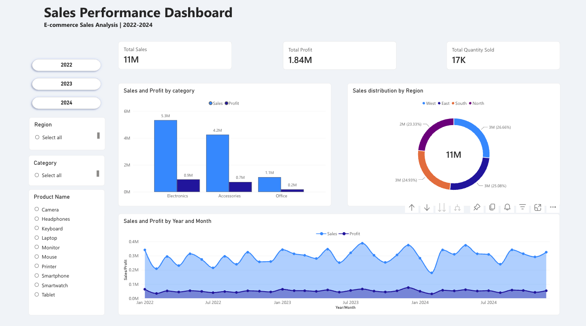

# E-commerce Sales Performance Analysis (2022–2024)

## Project Overview

This project explores e-commerce sales data downloaded from Kaggle to evaluate overall business performance. Using SQL and Power BI, I conducted data quality checks, analysed sales and profitability, and developed an interactive dashboard to communicate key business insights.

The analysis focuses on understanding how the business performed across different product categories, geographical regions and time periods.

## Key Questions

- How did overall sales and profit perform over the three-year period?
- Which product categories contributed most to total sales and profit?
- How were sales distributed across geographical regions?
- What monthly trends and variations can be observed in sales and profit?
- How did individual products contribute to overall sales performance?

## About the Data

The dataset was obtained from Kaggle:

[E-commerce Sales Performance Analysis – Kaggle](https://www.kaggle.com/datasets/sidramazam/e-commerce-sales-performance-analysis/data)

Before proceeding with the analysis, I used SQL in Google BigQuery to assess the dataset's quality. The checks included:

- Identifying missing (NULL) values.
- Checking for duplicate records.
- Validating column data types.
- Reviewing the dataset structure and values.

The checks identified no missing values or duplicate records, and the column data types were appropriate for the analysis.

**Note:** The dataset does not specify a currency. Therefore, monetary values are presented as provided in the original dataset, without assigning a specific currency.

## Tools

- **Google BigQuery (SQL):** Data exploration, validation and quality checks.
- **Power BI:** Data modelling, visualisation and interactive dashboard development.

## SQL Queries

The SQL queries used for data quality checks can be found here:

[SQL – Basic Data Quality Checks](sql_query/01_basic_checks_ecommerce_sales_data.sql)

## Dashboard

The interactive Power BI dashboard combines all three years of data and provides an overview of:

- Key performance indicators: Total Sales, Total Profit and Total Quantity Sold.
- Sales and profit performance by product category.
- Regional sales distribution.
- Monthly sales and profit trends.
- Interactive filtering by year, region, category and product.

## Key Findings

- **Business performance:** The business generated 10.67 million in sales and 1.84 million in profit over the three-year period.
- **Best year:** 2023 recorded the highest sales over the period.
- **Leading category:** Electronics contributed the most revenue.
- **Regional performance:** The West region recorded slightly higher sales, although overall sales were relatively balanced across regions.
- **Top-performing products:** Cameras and monitors were among the leading products in terms of sales.

The table below presents the top five products by total sales, alongside their corresponding profit contributions.

| Product Name | Total Sales | Profit |
|---|---:|---:|
| Camera | 1177381 | 207630.99 |
| Monitor | 1160048 | 202028.17 |
| Printer | 1094216 | 185394.88 |
| Mouse | 1074398 | 185763.69 |
| Smartphone | 1069681 | 183296.97 |
